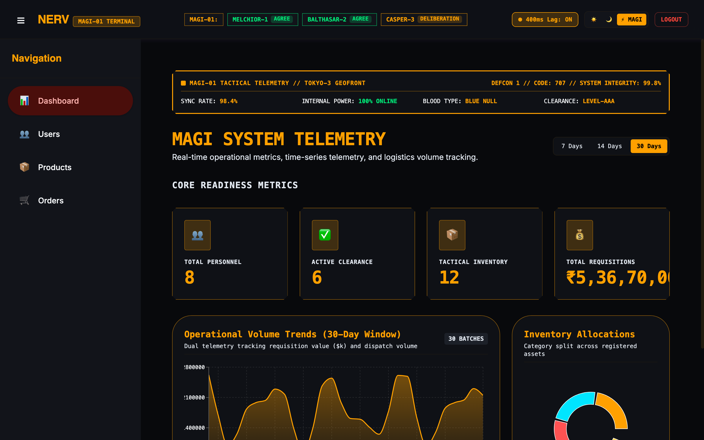
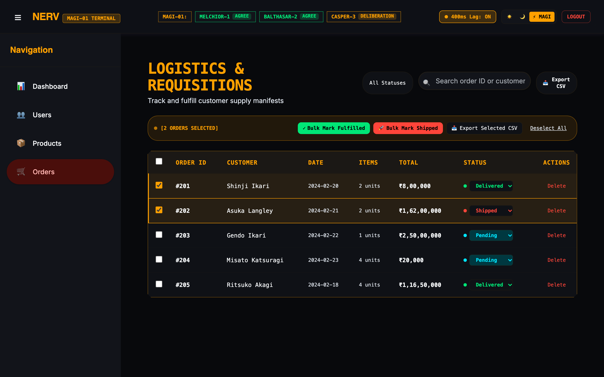
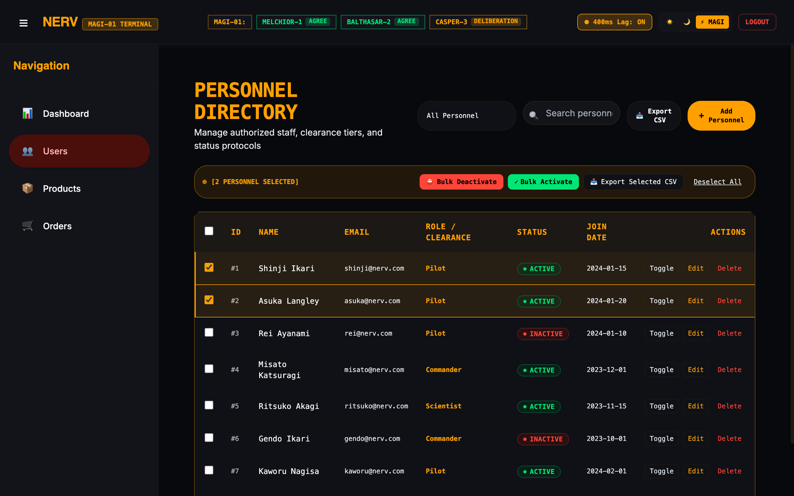
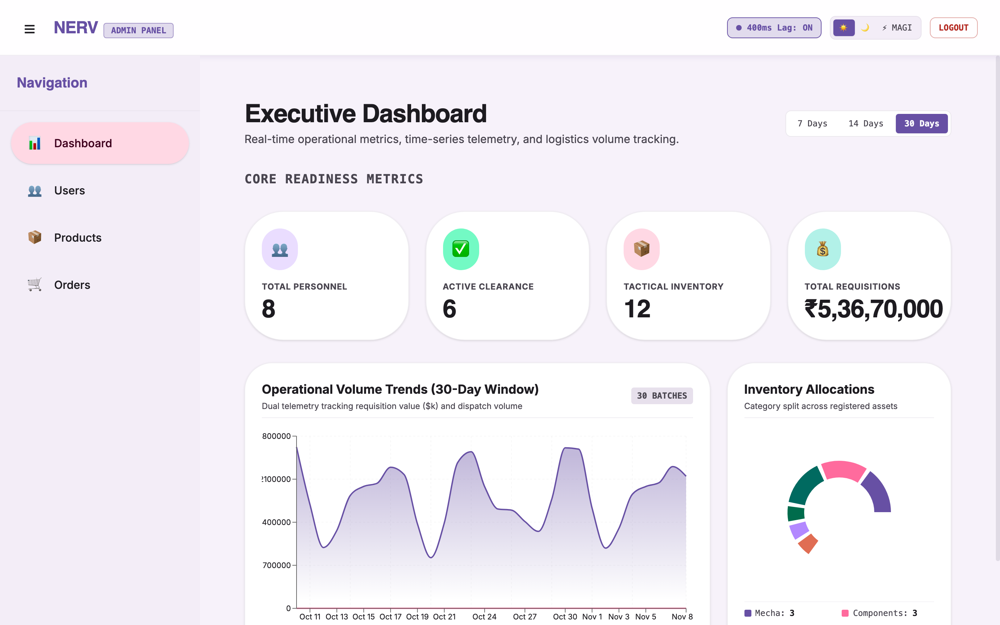
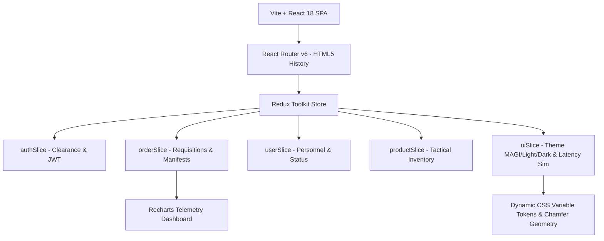

# NERV Tactical Operations Admin Panel ⚡

[](https://kanishk-upadhyay.github.io/NERV-admin-panel/)
[](https://react.dev/)
[](https://redux-toolkit.js.org/)
[](https://recharts.org/)
[](LICENSE)

An enterprise-grade tactical operations dashboard and state management platform inspired by **Evangelion's MAGI System** (`MELCHIOR-1`, `BALTHASAR-2`, `CASPER-3`). Features **Material 3 Expressive** and **Authentic MAGI Terminal Mode**, real-time time-series telemetry charts, bulk data operations with manifest export, and simulated async latency with optimistic UI rollbacks.

---

## 📸 Visual Showcase

### MAGI Tactical Terminal Mode
> Authentic phosphor orange (`#ffa000`), deep void (`#0a0a0c`), crisp vector typography, MAGI consensus telemetry module, and dynamic 30-day time-series telemetry charts.



---

### Bulk Table Operations & Manifest Export
> Multi-row selection, batch state transitions ("Bulk Mark Fulfilled", "Bulk Deactivate"), and client-side RFC 4180 CSV manifest export.

| Requisitions Bulk Dispatch | Personnel Directory Operations |
| :---: | :---: |
|  |  |

---

### Standard Material 3 Expressive Mode
> Full three-way design system support: instant toggling between **MAGI Terminal**, **Material 3 Expressive Light**, and **Material 3 Dark**.



---

## ⚡ Core Upgrades & Feature Highlights

### 1. Authentic MAGI / NERV Tactical Terminal Mode
- **Phosphor Amber & Void Palette**: Deep `#0b0d10` backdrop with `#ff9900` amber and `#00e5ff` cyan telemetry accents.
- **MAGI Tri-Computer Consensus Telemetry**: Real-time Navbar status indicators reflecting consensus between `MELCHIOR-1`, `BALTHASAR-2`, and `CASPER-3`.
- **Vector Chamfers & Monospace HUD**: High-tech typography with Google Fonts `Share Tech Mono`, 45-degree mechanical chamfers, and crisp anime-accurate telemetry styling without blurry scanline artifacts.

### 2. Time-Series Telemetry Charts (Recharts)
- **30-Day Revenue & Order Volume AreaChart**: Interactive dual-metric gradient area chart with 7, 14, and 30-day operational windows.
- **Product Category Donut Chart**: Visual distribution of tactical ordnance and equipment across EVA units, defense infrastructure, and communications.
- **Operational Status Gauges**: Real-time compute load and operational readiness meters.

### 3. Bulk Table Operations & CSV Manifest Export
- **Batch State Mutations**: Checkbox multi-selection in Requisitions (`Orders.jsx`) and Personnel (`Users.jsx`) for atomic batch actions.
- **Client-Side Manifest Export**: Instant RFC 4180 compliant CSV export of filtered views for logistics auditing.

### 4. Simulated Network Latency & Optimistic Rollbacks
- **Production-Grade Async State Handling**: Toggle simulated 400ms server latency directly from the Navbar.
- **Optimistic State Updates**: Table rows show pulsating pending indicators during dispatch and roll back automatically with error toasts upon server faults.

---

## 🏗️ Architecture & Technology Stack



- **Frontend Framework**: React 18 with React Router v6 (`<BrowserRouter basename="/NERV-admin-panel">`)
- **State Architecture**: Redux Toolkit slices with zero-redundancy memoized selectors (`createSelector`)
- **Telemetry & Visualization**: Recharts `ResponsiveContainer`, `AreaChart`, and `PieChart`
- **Design Systems**: Custom CSS tokens (`[data-theme="magi"]`), Material 3 Expressive gradients, and glassmorphic elevations

---

## 🚀 Getting Started

### Prerequisites
- Node.js 18+
- npm or yarn

### Installation
```bash
# Clone the repository
git clone https://github.com/kanishk-upadhyay/NERV-admin-panel.git
cd NERV-admin-panel

# Install dependencies
npm install

# Start development server
npm run dev
```

### Production Build & Preview
```bash
npm run build
npx vite preview --port 5175
```

---

## 📜 License
MIT License. Created by [Kanishk Upadhyay](https://github.com/kanishk-upadhyay).
